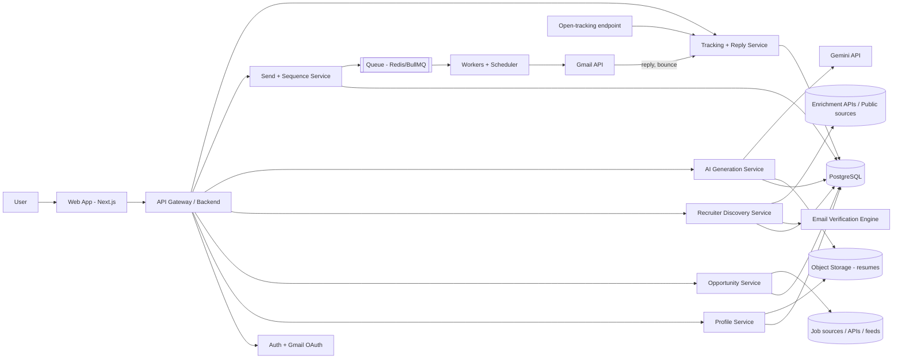
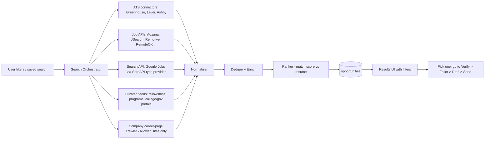
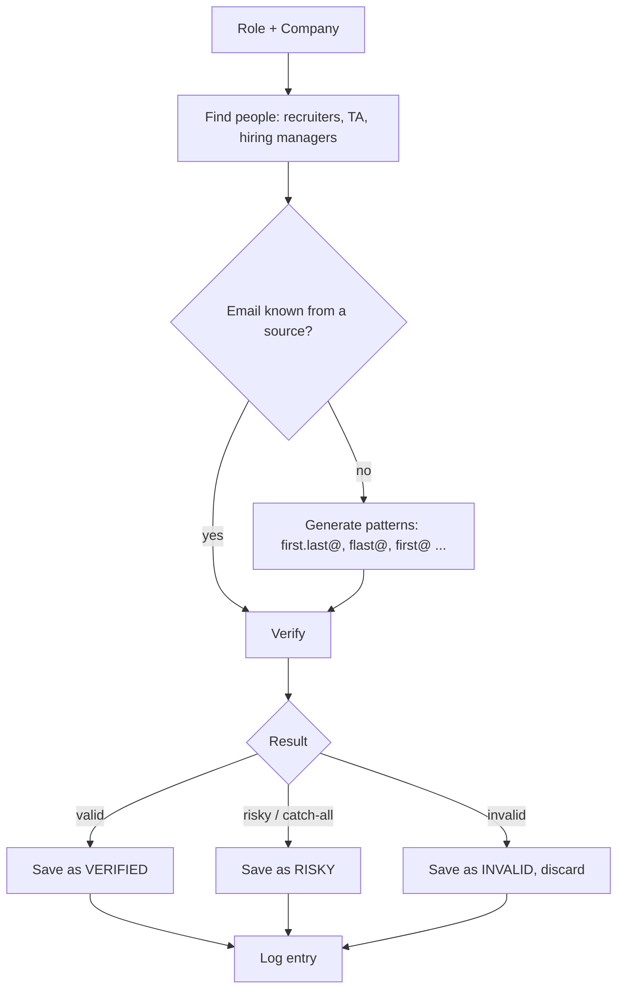
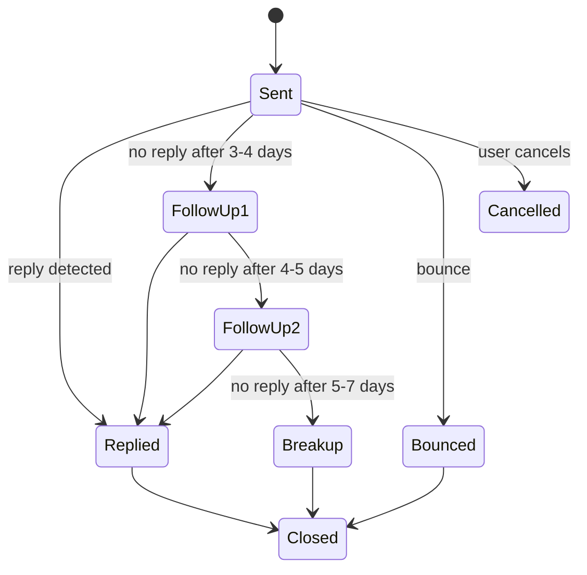

# Cold Outreach Agent: Architecture

A platform to apply to **internships, fellowships and jobs** by emailing recruiters directly. It finds and verifies recruiter emails, connects the user's own Gmail, generates a tailored email and resume for each role, sends it, follows up, and logs everything.

Reference flow: [FetchrLy – How it works](https://www.fetchrly.co.in/how-it-works) (7-step pipeline: Ingest → Roles → Verify → Tailor → Draft → Send → Track).

---

## 1. Goals and Non-Goals

**Goals**
- Upload a resume once and build a structured candidate profile.
- Discover opportunities (internships, fellowships, jobs) and the people who hire for them.
- Find and verify recruiter emails, and keep a **log of every fetched contact** and its verification result.
- Connect the user's own Gmail and send 1-to-1 emails from it with a tailored resume attached.
- Run automated follow-up sequences and track the outcome of each application.
- Keep the user in control: **nothing is sent without human approval.**

**Non-Goals (v1)**
- Bulk or mass mailing and third-party relay sending.
- Scraping behind logins.
- Replacing job boards. They are only a source of opportunities.

---

## 2. High-Level Architecture



---

## 3. The Pipeline (7 Stages)

| # | Stage | What happens | Key tech |
|---|-------|--------------|----------|
| 1 | **Ingest** | Upload a PDF or DOCX resume. Parse it into a structured profile (skills, projects, metrics, education). | PyMuPDF, spaCy, Gemini for structuring |
| 2 | **Roles** | The user adds a target role (paste a job link, JD, or search). The system extracts the company, role, location, keywords and domain. | Job API/feeds, JD parser |
| 3 | **Verify** | Find recruiters or hiring managers at the company, generate candidate emails, and verify them. Log every attempt. | MX lookup, SMTP handshake, catch-all detection |
| 4 | **Tailor** | Adjust resume bullets and keywords per role while keeping the original layout. | PyMuPDF text-box edits, LLM rewrite, diff view |
| 5 | **Draft** | Generate a short, grounded email from real resume metrics. Run a spam and authenticity check. | LLM, spam-word scan, personalization checks |
| 6 | **Send** | The user approves. The email goes out from the user's Gmail with the tailored resume attached. | Gmail API (`users.messages.send`) |
| 7 | **Track** | Track opens, replies and bounces. Run follow-ups (up to 3 steps) and update the pipeline status. | Tracking pixel, Gmail threads, scheduler |

### Human-in-the-loop gate
Between stages 5 and 6 the user must review the **recipient, subject, body and attached resume**. No auto-send without explicit approval.

---

## 3.1 Opportunity Discovery: Filtered Search Across the Internet

Stage 2 (Roles) is not only "paste a JD". The platform also **finds opportunities for the user** by searching many sources at once and letting them filter the results.

### Architecture



### Filters

| Filter | Examples |
|--------|----------|
| Type | Internship, fellowship, full-time, part-time, contract |
| Keywords / role | "ML intern", "backend", "policy fellowship" |
| Location | City, country, remote, hybrid, "India only" |
| Experience level | Student, fresher, 1-3 yrs |
| Skills | Match against skills in the parsed resume |
| Company | Size, industry, specific companies, startup vs MNC |
| Stipend / salary | Min stipend or range, currency |
| Posted date | Last 24h, 7 days, 30 days |
| Duration / start date | For internships and fellowships (3 months, summer 2027) |
| Deadline | Closing soon |
| Eligibility | Degree, graduation year, nationality, gender-specific programs |
| Has recruiter contact | Only show roles where a verified contact is likely findable |

### Source tiers

| Tier | Sources | Notes |
|------|---------|-------|
| **1. Official ATS boards** (best data quality) | Greenhouse, Lever, Ashby, Workable and similar public job-board endpoints | Free and structured. Need a list of company board slugs, which you build and grow over time. |
| **2. Job aggregator APIs** | Adzuna, JSearch (RapidAPI), Remotive, RemoteOK, Himalayas and similar | Licensed, rate-limited, mixed coverage. Verify India coverage per provider. |
| **3. Search-engine style** | A Google Jobs-type API via a SERP provider | Wide reach, paid per query. |
| **4. Curated feeds** | Fellowship and program pages, university and government portals, hackathon and startup-program lists | Often have no API, so use RSS or a maintained list with per-source parsers. |
| **5. Crawler** | Company career pages | Only where `robots.txt` and terms allow it. |

**Avoid**: scraping LinkedIn, Indeed, Glassdoor or any site whose terms forbid it. It risks IP bans and legal trouble. Link out to them instead, or use their official partner APIs if you get access. Check the terms of every source (including Internshala, Unstop, Wellfound) before ingesting.

### Pipeline steps
1. **Orchestrate**: fan out the query to the relevant connectors in parallel, with a timeout per source. Failures in one source don't block the others.
2. **Normalize**: map every source to one schema (`title, company, location, type, stipend, posted_at, deadline, apply_url, jd_text, source`).
3. **Dedupe**: the same job often appears on 3 sites. Match on a hash of (normalized company + title + location) plus fuzzy similarity; keep the best source, usually the official ATS.
4. **Enrich**: Gemini extracts structured fields from messy JD text (skills, eligibility, stipend, duration) with a response schema; company domain is resolved here, which is needed later for recruiter lookup.
5. **Rank**: score each result against the user's resume (skill overlap, role match, location, level). Use embeddings for semantic similarity plus rule-based filters, and show a "why this matches" line.
6. **Filter out junk**: expired postings, duplicate listings, obvious spam or fee-charging "jobs", and ghost jobs (no update for a long time).
7. **Cache and refresh**: cache results for a short TTL and refresh in the background, so searches feel instant and API quotas are saved.

### Saved searches and alerts
- Users save a filter set, for example "ML internships, India or remote, stipend above 20k".
- A scheduled job re-runs saved searches daily, finds **new** opportunities and notifies the user (in-app and email).
- Optional: one-click "draft outreach for all new matches" that prepares drafts for review and never sends them automatically.

### Link to the rest of the pipeline
Each result has a **Find recruiter** button. It passes the company domain into the Verify stage, so discovery, recruiter lookup, tailoring, drafting and sending flow as one path.

---

## 4. Components

### 4.1 Frontend (Next.js + Tailwind)
- **Dashboard**: funnel (found → drafted → sent → opened → replied) and credits/quota.
- **Profile**: parsed resume editor, with the ability to correct extracted fields.
- **Opportunities**: saved jobs, internships and fellowships.
- **Compose / Review**: draft, resume diff, recipient picker, approve & send.
- **Contacts Log**: every fetched recruiter email with status (see 5.3).
- **Sequences**: per-application follow-up timeline with pause/cancel.
- **Email History**: sent mail, threads, replies.

### 4.2 Backend (Node/TypeScript or FastAPI)
Modular monolith first; split services later if needed.

| Module | Responsibility |
|--------|----------------|
| `auth` | Sign-in, Gmail OAuth, token refresh |
| `profile` | Resume upload, parsing, versioning |
| `opportunities` | Source connectors, filtered search, normalize, dedupe, rank, saved searches and alerts |
| `discovery` | Recruiter search, email pattern generation, verification, logging |
| `generation` | Email and resume tailoring via LLM |
| `sending` | Queueing, rate limiting, Gmail dispatch |
| `sequences` | Follow-up state machine and scheduler |
| `tracking` | Open pixel, reply and bounce detection |
| `billing` | Credits, refunds on failed discovery |

### 4.3 Workers
- Resume parsing, recruiter discovery and verification, LLM generation, email sending, follow-up scheduling and reply polling all run as **async jobs** on a queue.
- Retries use exponential backoff. Failed jobs go to a dead-letter queue.

### 4.4 Storage
- **PostgreSQL**: all relational data.
- **Object storage (S3 / Supabase Storage)**: original and tailored resumes, with per-user encryption and signed URLs.
- **Redis**: queue, rate-limit counters, caches.

---

## 5. Recruiter Email Fetching and Logging

### 5.1 Discovery flow



Sources (choose based on licensing and cost): company careers pages and job posts that list contact emails, public professional profiles via compliant APIs, enrichment APIs (Hunter-style, Apollo-style), and the user's own contacts. Avoid scraping sites that forbid it.

### 5.2 Verification steps
1. Syntax check.
2. DNS **MX** lookup of the domain.
3. **SMTP handshake** (`RCPT TO`) without sending a message.
4. **Catch-all** detection (the domain accepts everything, so the result is "risky").
5. Role-account and disposable-domain filters (`info@`, `noreply@`).
6. Re-verify before sending if the last check is older than N days.

If no verified contact is found, **refund the credit automatically**.

### 5.3 Contacts log (what you asked for: "logs of fetched recruiter mail")

Every attempt writes a row to `recruiter_contacts` and `discovery_logs`, so the user can see what was fetched, from where, and how reliable it is.

| Field | Example |
|-------|---------|
| contact | Priya S., Talent Acquisition, Acme |
| email | priya.s@acme.com |
| source | `careers_page` / `enrichment_api` / `pattern_guess` |
| verification_status | `verified` / `risky` / `invalid` / `unknown` |
| verified_at | timestamp |
| fetched_for | opportunity_id |
| times_emailed | 1 |
| last_outcome | `opened`, `replied`, `bounced`, none |
| do_not_contact | boolean |

---

## 6. Data Model (core tables)

```sql
users(id, email, name, country, credits, created_at)

gmail_accounts(id, user_id, google_email, refresh_token_enc, scopes,
               daily_send_cap, status, connected_at)

resumes(id, user_id, version, file_url, parsed_json, is_base, created_at)

opportunities(id, user_id, type,            -- job | internship | fellowship
              title, company, company_domain, location, remote_type,
              stipend_min, stipend_max, currency, duration, deadline,
              posted_at, jd_text, jd_keywords, eligibility_json,
              source, source_url, apply_url, dedupe_hash,
              match_score, match_reason, status, created_at)

job_sources(id, name, tier, connector, base_url, rate_limit, enabled)

company_boards(id, company, domain, ats_type,   -- greenhouse | lever | ashby ...
               board_slug, last_crawled_at)

saved_searches(id, user_id, name, filters_json, frequency,
               last_run_at, notify, created_at)

recruiter_contacts(id, company, full_name, title, email, source,
                   verification_status, verified_at, do_not_contact)

discovery_logs(id, opportunity_id, contact_id, step, result, raw_response,
               credit_charged, created_at)

applications(id, user_id, opportunity_id, contact_id, tailored_resume_id,
             status,                        -- drafted|approved|sent|opened|replied|bounced|closed
             created_at)

emails(id, application_id, sequence_step,   -- 0 = initial, 1..3 = follow-ups
       subject, body, gmail_message_id, gmail_thread_id,
       scheduled_at, sent_at, status)

email_events(id, email_id, type,            -- open|reply|bounce|unsubscribe
             meta, occurred_at)

sequences(id, application_id, steps_json, state, paused_at, cancelled_at)

suppression_list(id, email, reason, created_at)
```

---

## 7. Gmail Integration

- **OAuth 2.0** with the minimum scopes. `gmail.send` to send. Reading replies needs a read scope, which Google classes as restricted and which requires a security assessment. For v1, consider detecting replies with limited-scope checks or letting the user mark replies manually, then upgrade later.
- Refresh tokens are **encrypted at rest** (KMS / envelope encryption).
- Send as a **MIME message with the resume attached**, inside the same thread for follow-ups (`threadId`, `In-Reply-To`, `References` headers).
- **Per-user daily cap** (suggest 30–50/day, well below Gmail's limits) plus jittered delays between sends to protect the user's sender reputation.
- Handle token revocation: pause sequences and notify the user.

---

## 8. Follow-up Sequences



- **Branching**: different copy if the previous mail was opened vs unopened.
- Stop on reply, bounce, unsubscribe or user cancel.
- Send only in the recipient's business hours (time-zone aware).
- Each follow-up goes through the same review rule: the user approves the sequence upfront, and can pause or cancel anytime.

---

## 9. Tracking

| Signal | How | Caveat |
|--------|-----|--------|
| **Open** | 1×1 pixel served from `/t/{token}.gif` | Unreliable: image blocking and Apple Mail prefetching inflate or hide opens. Treat as a hint, not truth. |
| **Reply** | Gmail thread check (needs read scope) | Most reliable signal |
| **Bounce** | Delivery-status messages in the inbox | Add the address to the suppression list |
| **Click** | Optional redirect link (portfolio, GitHub) | Keep minimal; heavy link rewriting hurts deliverability |

Tracking pixels should be disclosed in the privacy policy, and the user should be able to switch them off.

---

## 10. AI Generation Service

### 10.0 Gemini integration

All LLM calls go through one internal `llm` module, so the model can be swapped later without touching business logic.

| Task | Model tier | Output mode |
|------|-----------|-------------|
| Resume to structured profile | Fast/cheap tier (Flash-class) | JSON with `response_schema` |
| JD parsing (company, role, keywords) | Fast/cheap tier | JSON with `response_schema` |
| Resume bullet tailoring | Fast tier, or stronger tier if quality is weak | JSON: `[{bullet_id, new_text}]` |
| Cold email draft and follow-ups | Fast tier | JSON: `{subject, body}` |
| Authenticity / spam review (optional second pass) | Fast tier | JSON score + reasons |

Check Google's current model list before pinning model names, since they change often. Keep the model name in config, not in code.

**Integration rules**
- Use the **Google Gen AI SDK** with an API key from Google AI Studio for the MVP. Move to **Vertex AI** if you need data-residency or enterprise controls.
- Force **structured output** (JSON mode + response schema) and validate it with Pydantic/Zod. On a schema failure, retry once, then fail the job.
- Keep **temperature low** (about 0.3 to 0.5) for parsing and tailoring, and slightly higher for email drafting.
- Run Gemini calls inside **queue workers** with timeouts, retries with backoff, and a per-user rate limit, so a quota error never blocks the UI.
- Track **tokens per request** in `discovery_logs` / a `llm_usage` table so credit pricing covers real cost.
- Cache parsed profiles and JD parses, because they are reused across many applications.
- **Privacy:** resumes contain personal data. Check the Gemini API terms on data use (paid vs free tier handling differs), disclose it in the privacy policy, and strip data the model doesn't need, such as phone number and home address, before sending.
- **Safety filters:** handle blocked or empty responses explicitly, and never send an email whose generation was blocked or truncated.

### 10.1 Resume tailoring and email drafting

**Resume tailoring**
- Input: base resume, JD keywords. Output: edited bullet text only.
- Preserve layout by editing the text within its original bounding boxes (PyMuPDF), and refuse a rewrite that overflows the box.
- Always show a **diff** (before/after) for the user to accept per bullet.
- **Never invent** skills, employers or metrics. Only reword what's in the parsed profile.

**Email drafting**
- Prompt grounded in: parsed profile highlights + JD + recruiter name/title + company.
- Target 80–120 words, one clear ask, no attachments beyond the resume.
- Post-checks: spam-word scan, placeholder leak check (`[Company]`), duplicate-text similarity across a user's sent emails, and an "authenticity" score.
- Different templates per type: internship, fellowship (more academic, mention program/mentor fit), full-time job.

---

## 11. Suggested Tech Stack

| Layer | Choice |
|-------|--------|
| Frontend | Next.js, TypeScript, Tailwind, shadcn/ui |
| Backend | FastAPI (Python, good for parsing and ML libs) or NestJS |
| DB | PostgreSQL (Supabase or RDS) |
| Queue / Cache | Redis + BullMQ (or Celery) |
| Storage | S3 / Supabase Storage |
| Parsing | PyMuPDF, spaCy, python-docx |
| LLM | Gemini API (Google AI Studio / Vertex AI), using JSON mode with a response schema for profile and JD parsing |
| Email | Gmail API, SMTP-verification microservice |
| Auth | Supabase Auth / Auth.js + Google OAuth |
| Payments | Razorpay (India) / Stripe (global), credit packs |
| Infra | Docker, Fly.io / Railway / AWS ECS, Cloudflare |
| Observability | Sentry, OpenTelemetry, structured logs |

**SMTP verification note**: run it from a stable IP with proper reverse DNS. Cloud IPs are often blocked on port 25, so it may need a small dedicated VM.

---

## 12. API Sketch

```
POST   /auth/google/connect
POST   /resumes                      upload + parse
GET    /resumes/:id

POST   /opportunities                from URL or pasted JD
GET    /opportunities
GET    /opportunities/search         filtered multi-source search
                                     ?q=&type=&location=&remote=&posted_within=
                                      &min_stipend=&skills=&deadline_before=&page=
POST   /saved-searches               save filters + alert frequency
GET    /saved-searches
DELETE /saved-searches/:id

POST   /opportunities/:id/discover   find + verify recruiters (charges credit)
GET    /contacts                     the fetched-contacts log
PATCH  /contacts/:id                 mark do_not_contact

POST   /applications                 create draft (resume tailor + email)
PATCH  /applications/:id             edit draft
POST   /applications/:id/approve     user approval
POST   /applications/:id/send        enqueue send
POST   /applications/:id/sequence    configure follow-ups
POST   /applications/:id/cancel

GET    /t/:token.gif                 open pixel
GET    /unsubscribe/:token
```

---

## 13. Security, Privacy and Compliance

- **Encrypt** resumes and OAuth tokens. Use row-level security (users see only their data). Short-lived signed URLs.
- Give the user a way to **delete all data** and revoke Gmail access.
- **Data-protection laws**: India's DPDP Act 2023, GDPR (EU/UK recruiters), CAN-SPAM (US). Keep the content honest, include a clear way to opt out, honour opt-outs through the `suppression_list`, and store only the recruiter data needed. Get legal review before launch, especially around recruiter data sourcing.
- Respect the terms of each data source. Do not scrape platforms that prohibit it.
- Rate-limit APIs, add CAPTCHA at sign-up, and monitor abuse (this tool could be misused for spam, so cap volume and block bulk patterns).
- Secrets in a vault, audit logs for sends and approvals.

---

## 14. Deliverability Guardrails

- Send **1-to-1 from the user's own Gmail**, not via a shared relay.
- Daily caps, random delays, no identical copy at scale.
- Skip `risky` and `invalid` contacts by default (let the user opt in for risky).
- Auto-pause a user's sending if the bounce rate exceeds about 5%.
- Maintain a global and per-user suppression list.

---

## 15. Build Roadmap

| Phase | Scope |
|-------|-------|
| **MVP (3–4 wks)** | Auth + Gmail connect, resume parse, paste-a-JD opportunity + basic filtered search (Greenhouse/Lever/Ashby + one job API), manual recruiter email entry + MX/SMTP verify, AI draft, human approval, send with attachment, contacts log |
| **v1 (+3–4 wks)** | Automated recruiter discovery, resume tailoring with diff, follow-up sequences, open/reply/bounce tracking, credits and billing |
| **v2** | More sources (curated fellowship feeds, SERP-style search), resume-match ranking with embeddings, saved-search alerts, saved-job pipeline board, analytics (which subject lines get replies), browser extension to capture a job from any page, team/college-placement-cell mode |

---

## 16. Open Questions

1. Which recruiter data source(s) are we licensing, and at what cost per lookup?
2. Gmail only at launch, or Outlook as well?
3. Credit-based pricing (as in the reference) or subscription?
4. Do we need Gmail read access for reply detection in v1, given the security-review overhead?
5. Target market first: India internships/fellowships, or global jobs?
6. Which job APIs do we budget for, and how well do they cover Indian internships and fellowships?
7. Do we maintain our own list of company ATS board slugs, or buy one?
