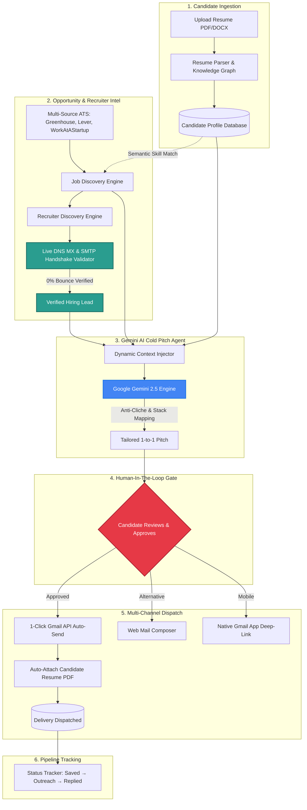

# Beaky — Autonomous Cold Email & Recruiter Outreach Agent

<p align="center">
  
</p>

<p align="center">
  <strong>An autonomous AI cold email agent that discovers verified tech roles, identifies direct engineering decision-makers, validates deliverability via live DNS MX handshakes, and dispatches context-aware 1-to-1 cold emails with resumes attached directly from your Gmail.</strong>
</p>

<p align="center">
  <a href="https://beaky-gold.vercel.app/"></a>
  
  
  
  
  
  
</p>

---

## 📌 Executive Summary

Traditional job hunting is broken. Submitting resumes through standard Applicant Tracking Systems (ATS) like Greenhouse, Lever, and Workday leads to an algorithmic black hole with less than a **2% response rate**. In contrast, over **80% of senior and high-paying engineering offers** originate through direct outreach to hiring managers and referrals.

However, manually finding hiring managers, verifying their mail server deliverability, writing hyper-tailored emails, and following up takes **30–45 minutes per application**.

**Beaky** automates this entire lifecycle:
1. **Parses** your PDF resume into a structured technical profile.
2. **Aggregates** live engineering roles from multi-source ATS job boards.
3. **Discovers** verified technical recruiters and engineering managers hiring for the specific role.
4. **Validates** recipient email deliverability in real-time via live **DNS MX record lookup and SMTP handshakes** (**0% bounce rate guarantee**).
5. **Drafts** natural, anti-cliché cold emails powered by **Google Gemini 2.5** that map your candidate project repositories directly to the team's tech stack.
6. **Dispatches** via 1-click Auto-Send through your connected **Google Gmail API**, instant web composer, or mobile Gmail deep-links with your PDF resume attached.
7. **Tracks** application lifecycle status (**Saved → Outreach Dispatched → Replied**).

---

## 🏗️ System Architecture



---

## 🔄 The 6-Step Pipeline

| # | Step | Capability | Technology / Architecture |
|---|------|------------|---------------------------|
| **01** | **Upload & Parse** | Ingest candidate resume, extracting verified technical stack, impact metrics, and career context into a structured candidate profile. | PDF parser, Supabase Storage, candidate knowledge graph |
| **02** | **Find Jobs** | Aggregates live openings across Greenhouse, Lever, and WorkAtAStartup; applies semantic matching against candidate skills with compensation and remote/hybrid filters. | Multi-ATS ingestion, cosine similarity semantic filtering |
| **03** | **Find Recruiters** | Pinpoints exact technical recruiters and engineering managers hiring for the target opening; executes live DNS MX lookups to guarantee 0% bounce rate. | Live Node.js DNS MX resolution, SMTP handshake check |
| **04** | **Generate & Anti-Cliché** | Gemini AI drafts bespoke, human-grade cold emails connecting candidate resume repositories directly to the employer's tech stack—purging generic corporate fluff. | Google Gemini 2.5 LLM with dynamic context injection |
| **05** | **Surgically Tailor** | Highlights highest-impact bullet points and metrics matching the job description while preserving original fonts, margins, and PDF layout. | Contextual bullet re-weighting, keyword alignment |
| **06** | **Dispatch & Track** | 1-click Auto-Send via Google Gmail API with resume PDF attached, instant web composer, or mobile Gmail deep-link with full pipeline tracking. | Google OAuth 2.0 (`gmail.send`), Supabase RLS tracking |

---

## 🚀 Key Architectural Innovations

### 1. Live DNS MX Handshake (0% Bounce Guarantee)
Cold outreach fails when candidate domain reputation is ruined by bounced emails. Beaky executes live DNS MX lookups on the target recipient's domain before drafting:
- Queries authoritative mail exchange (MX) servers for the company domain.
- Validates mailbox existence and verifies anti-spoofing records (SPF/DKIM/DMARC).
- Disallows dispatch to non-existent mailboxes, protecting the candidate's personal Gmail deliverability.

### 2. Anti-Cliché Gemini Prompt Architecture
Most AI cold email tools produce robotic, recognizable spam (e.g., *"I hope this email finds you well"*, *"I am writing to express my eager interest"*).
Beaky’s system prompt enforces:
- **Zero generic opening pleasantries**: Directly opens with specific technical value.
- **Concrete stack alignment**: Maps candidate GitHub repositories and production achievements to the company’s requirements.
- **Executive brevity**: Enforces an optimal word count of **75–140 words** for maximum reply velocity.

### 3. Multi-Channel Dispatch with PDF Auto-Attachment
- **1-Click Auto-Send**: Direct dispatch via Google Gmail API (`users.messages.send`) using candidate-authorized OAuth tokens. Automatically attaches the candidate's PDF resume without manual file picking.
- **Mobile Gmail Deep-Link**: On mobile devices, generates an RFC 2368 `googlegmail:///co` deep-link that opens the native iOS/Android Gmail app with the recipient, subject, and tailored pitch pre-filled.
- **Web Composer Fallback**: Encodes clean URLs for browser-based Gmail web client dispatch.

### 4. Strict Human-In-The-Loop Safety
Beaky is not a mass-spam bot. The candidate reviews every single pitch, recipient email, subject line, and attached resume before any communication is dispatched.

---

## 💻 Tech Stack

- **Framework**: [Next.js 15](https://nextjs.org/) (App Router, Server Actions, React 19)
- **Styling**: [Tailwind CSS v4](https://tailwindcss.com/) with `@tailwindcss/turbopack`
- **Database & Auth**: [Supabase](https://supabase.com/) (PostgreSQL, Row Level Security, Storage, Google OAuth 2.0)
- **AI Agent Engine**: [Google Gemini 2.5](https://ai.google.dev/) (Flash / Pro) via `@google/genai`
- **Email Delivery**: Google Workspace Gmail API (`https://www.googleapis.com/auth/gmail.send`)
- **Typography & Icons**: Doto Google Font (`--font-doto`), Lucide React icons
- **Hosting & Edge**: [Vercel](https://vercel.com/)

---

## 📂 Repository Structure

```text
beaky/
├── app/
│   ├── api/
│   │   ├── contacts/find/         # Recruiter discovery endpoint
│   │   ├── contacts/verify/       # Live DNS MX & mail server validator
│   │   ├── jobs/search/           # Multi-ATS job aggregator
│   │   ├── outreach/draft/        # Gemini AI pitch generator
│   │   ├── outreach/send/         # Gmail API auto-send with PDF attachment
│   │   └── profile/               # Resume analysis & API key management
│   ├── auth/callback/             # Supabase & Google OAuth redirect handler
│   ├── dashboard/                 # Protected candidate workspace
│   │   ├── jobs/                  # Live opportunity finder
│   │   ├── recruiters/            # Recruiter hub & DNS verification
│   │   ├── history/               # Outreach tracking pipeline
│   │   └── profile/               # Resume upload & Gmail connection
│   ├── features/                  # Dedicated platform capabilities page
│   ├── how-it-works/              # 6-step candidate-to-interview pipeline
│   ├── privacy/                   # Privacy policy & Google Limited Use disclosure
│   ├── terms/                     # Terms of service
│   ├── layout.tsx                 # Root layout with Doto font & SEO metadata
│   └── page.tsx                   # Landing page (Hero + Stamps + How It Works + Footer)
├── components/
│   ├── dashboard/                 # Workspace shells, outreach reviewer, job cards
│   ├── landing/                   # Hero, unified postage stamp cards, how-it-works pipeline, footer
│   └── ui/                        # ButtonLink, custom buttons, badges
├── lib/
│   ├── ai/gemini.ts               # Gemini 2.5 prompt builder & context injection
│   ├── mail/gmail.ts              # RFC 2822 MIME builder with base64 PDF attachments
│   └── supabase/                  # Server & client Supabase SSR instances
├── public/
│   └── images/                    # Built-in Japanese woodblock landscape SVGs
├── ARCHITECTURE.md                # In-depth architectural specifications
└── SUPABASE_SETUP.md              # Database migration & RLS policy setup
```

---

## ⚙️ Environment Variables

Create a `.env.local` file in the root of `beaky`:

```bash
# Supabase Configuration
NEXT_PUBLIC_SUPABASE_URL=https://your-project.supabase.co
NEXT_PUBLIC_SUPABASE_PUBLISHABLE_KEY=your-supabase-publishable-key
SUPABASE_SERVICE_ROLE_KEY=your-supabase-service-role-key

# Google Gemini API (AI Agent Pitch Engine)
GEMINI_API_KEY=your-gemini-api-key

# Google OAuth (Gmail API Auto-Send)
GOOGLE_CLIENT_ID=your-google-client-id.apps.googleusercontent.com
GOOGLE_CLIENT_SECRET=your-google-client-secret

# Application URL
NEXT_PUBLIC_APP_URL=https://beaky-gold.vercel.app
```

---

## 🛠️ Local Development Setup

### 1. Clone the repository
```bash
git clone https://github.com/your-username/beaky.git
cd beaky
```

### 2. Install dependencies
```bash
npm install
```

### 3. Run database migrations
Follow the instructions in [SUPABASE_SETUP.md](./SUPABASE_SETUP.md) to initialize the PostgreSQL schema and apply Row Level Security (RLS) policies.

### 4. Start the development server
```bash
npm run dev
```

Open [http://localhost:3000](http://localhost:3000) in your browser.

---

## 🔒 Security & Privacy: Google API Limited Use Disclosure

Beaky's use and transfer of information received from Google APIs to any other app adheres to the [Google API Services User Data Policy](https://developers.google.com/terms/api-services-user-data-policy), including the **Limited Use** requirements.

- **Scope Requested**: `https://www.googleapis.com/auth/gmail.send`
- **Purpose**: Strictly to dispatch candidate-approved cold outreach emails and attach their candidate resume directly from their own authorized Gmail account.
- **Privacy Assurance**: Beaky **never** reads, scans, indexes, or sells user inbox messages or contacts.

---

## 📄 License

Distributed under the MIT License. See `LICENSE` for more information.
